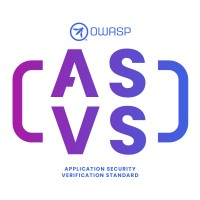

{ align=right width=180 }

The [Application Security Verification Standard][asvs] (ASVS) is a long established OWASP flagship project,
and is widely used to build a culture of security as well as verification of web applications.

It can be downloaded from the [OWASP project page][asvs] in various languages and formats:
PDF, Word, CSV, XML and JSON. Having said that, the recommended way to consume the ASVS is to access
the [github markdown][asvsmd] pages directly - this will ensure that the latest version is used.

#### What is ASVS?

The ASVS is an open standard that sets out the coverage and level of rigor expected when it comes to
performing web application security verification.
The standard also provides a basis for testing any technical security controls
that are relied on to protect against vulnerabilities in the application.

The ASVS is split into various sections:

* V1 [Encoding and Sanitization][asvsV1]
* V2 [Validation and Business Logic][asvsV2]
* V3 [Web Frontend Security][asvsV3]
* V4 [API and Web Service][asvsV4]
* V5 [File Handling][asvsV5]
* V6 [Authentication][asvsV6]
* V7 [Session Management][asvsV7]
* V8 [Authorization][asvsV8]
* V9 [Self-contained Tokens][asvsV9]
* V10 [OAuth and OIDC][asvsV10]
* V11 [Cryptography][asvsV11]
* V12 [Secure Communication][asvsV12]
* V13 [Configuration][asvsV13]
* V14 [Data Protection][asvsV14]
* V15 [Secure Coding and Architecture][asvsV15]
* V16 [Security Logging and Error Handling][asvsV16]
* V17 [WebRTC][asvsV17]

The ASVS defines three [levels of security verification][asvsL123]:

1. the minimum requirements and a critical starting point for any application, around 20% of the requirements
2. applications which contain sensitive data that require protection; the recommended level for most applications
3. the most critical applications that require the highest level of trust

Most applications will aim for Level 2, with only those applications that perform high value transactions,
or contain sensitive medical data, aiming for the highest level of trust at level 3.

#### Why use it?

The ASVS is well established, the earlier versions were written in 2008, and it has been continually supported since then.
The ASVS is used to generate security requirements, guide the verification process
and also to identify gaps in the application security.

The ASVS can also be used as a metric on how mature application security processes are;
it is a yardstick with which to assess the degree of trust that can be placed in the web application.
This helps provide a good security culture: the application developers and application owners can see how they are doing
and be confident in the maturity of their processes in comparison with other teams and organizations.

#### How to use it

The OWASP Spotlight series provides an overview of the ASVS and its uses:
'Project 19 - [OWASP Application Security Verification standard (ASVS)][spotlight19]'.

The appropriate ASVS level should be chosen from:

* Level 1: Minimum requirements, the starting point for every application
* Level 2: Most applications
* Level 3: High value, high assurance, or high safety

This is not a judgmental ranking, for example if an application needs only Level 1 protection then that is a valid choice.
Tools such as [SecurityRAT][srat] can then help create a subset of the ASVS security requirements for consideration.

Application developer teams and application owners can then gain familiarity with the appropriate security
requirements and incorporate them into the process and culture of the organization.
To help navigate the ASVS, the OWASP Cheat Sheets have been indexed specifically
for [each section of the ASVS][csasvs] which can be used to explain and expand on each requirements category.

#### References

* OWASP [Application Security Verification Standard][asvs] (ASVS)
* OWASP [Cheat Sheets for ASVS][csasvs]
* OWASP [SecurityRAT][srat]

----

The OWASP Developer Guide is a community effort; if there is something that needs changing
then [submit an issue][issue1004] or [edit on GitHub][edit1004].

[asvs]: https://owasp.org/projects/asvs
[asvsL123]: https://github.com/OWASP/ASVS/blob/v5.0.0/5.0/en/0x03-What-is-the-ASVS.md#application-security-verification-levels
[asvsmd]: https://github.com/OWASP/ASVS/tree/v5.0.0/5.0/en
[asvsV1]: https://github.com/OWASP/ASVS/blob/v5.0.0/5.0/en/0x10-V1-Encoding-and-Sanitization.md#v1-encoding-and-sanitization
[asvsV2]: https://github.com/OWASP/ASVS/blob/v5.0.0/5.0/en/0x11-V2-Validation-and-Business-Logic.md#v2-validation-and-business-logic
[asvsV3]: https://github.com/OWASP/ASVS/blob/v5.0.0/5.0/en/0x12-V3-Web-Frontend-Security.md#v3-web-frontend-security
[asvsV4]: https://github.com/OWASP/ASVS/blob/v5.0.0/5.0/en/0x13-V4-API-and-Web-Service.md#v4-api-and-web-service
[asvsV5]: https://github.com/OWASP/ASVS/blob/v5.0.0/5.0/en/0x14-V5-File-Handling.md#v5-file-handling
[asvsV6]: https://github.com/OWASP/ASVS/blob/v5.0.0/5.0/en/0x15-V6-Authentication.md#v6-authentication
[asvsV7]: https://github.com/OWASP/ASVS/blob/v5.0.0/5.0/en/0x16-V7-Session-Management.md#v7-session-management
[asvsV8]: https://github.com/OWASP/ASVS/blob/v5.0.0/5.0/en/0x17-V8-Authorization.md#v8-authorization
[asvsV9]: https://github.com/OWASP/ASVS/blob/v5.0.0/5.0/en/0x18-V9-Self-contained-Tokens.md#v9-self-contained-tokens
[asvsV10]: https://github.com/OWASP/ASVS/blob/v5.0.0/5.0/en/0x19-V10-OAuth-and-OIDC.md#v10-oauth-and-oidc
[asvsV11]: https://github.com/OWASP/ASVS/blob/v5.0.0/5.0/en/0x20-V11-Cryptography.md#v11-cryptography
[asvsV12]: https://github.com/OWASP/ASVS/blob/v5.0.0/5.0/en/0x21-V12-Secure-Communication.md#v12-secure-communication
[asvsV13]: https://github.com/OWASP/ASVS/blob/v5.0.0/5.0/en/0x22-V13-Configuration.md#v13-configuration
[asvsV14]: https://github.com/OWASP/ASVS/blob/v5.0.0/5.0/en/0x23-V14-Data-Protection.md#v14-data-protection
[asvsV15]: https://github.com/OWASP/ASVS/blob/v5.0.0/5.0/en/0x24-V15-Secure-Coding-and-Architecture.md#v15-secure-coding-and-architecture
[asvsV16]: https://github.com/OWASP/ASVS/blob/v5.0.0/5.0/en/0x25-V16-Security-Logging-and-Error-Handling.md#v16-security-logging-and-error-handling
[asvsV17]: https://github.com/OWASP/ASVS/blob/v5.0.0/5.0/en/0x26-V17-WebRTC.md#v17-webrtc
[csasvs]: https://cheatsheetseries.owasp.org/IndexASVS.html
[edit1004]: https://github.com/OWASP/DevGuide/blob/main/docs/en/08-culture-process/04-asvs.md
[issue1004]: https://github.com/OWASP/DevGuide/issues/new?labels=content&template=request.md&title=Update:%2008-culture-process/04-asvs
[spotlight19]: https://youtu.be/3puIavsZfAk
[srat]: https://owasp.org/projects/securityrat
