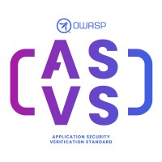

{ align=right width=180 }

The [Application Security Verification Standard][asvs] (ASVS) is a long established OWASP flagship project,
and is widely used to identify gaps in security as well as the verification of web applications.

It can be downloaded from the [OWASP project page][asvs] in various languages and formats:
PDF, Word, CSV, XML and JSON. Having said that, the recommended way to consume the ASVS is to access
the [github markdown][asvsmd] pages directly - this will ensure that the latest version is used.

#### What is ASVS?

The ASVS is an open standard that sets out the coverage and 'level of rigor' expected when it comes to
performing web application security verification.
For this reason it can be used to identify gaps in the security of web applications.

The ASVS is split into various sections:

* V1 [Encoding and Sanitization][asvsV1]
* V2 [Validation and Business Logic][asvsV2]
* V3 [Web Frontend Security][asvsV3]
* V4 [API and Web Service][asvsV4]
* V5 [File Handling][asvsV5]
* V6 [Authentication][asvsV6]
* V7 [Session Management][asvsV7]
* V8 [Authorization][asvsV8]
* V9 [Self-contained Tokens][asvsV9]
* V10 [OAuth and OIDC][asvsV10]
* V11 [Cryptography][asvsV11]
* V12 [Secure Communication][asvsV12]
* V13 [Configuration][asvsV13]
* V14 [Data Protection][asvsV14]
* V15 [Secure Coding and Architecture][asvsV15]
* V16 [Security Logging and Error Handling][asvsV16]
* V17 [WebRTC][asvsV17]

#### How to use it

The ASVS is a list of verification requirements that can be used to identify gaps in the security of web applications.
If the ASVS suggests using a control then that control should be considered for the application security,
it may be not applicable but at least the control should have been considered at some point in the development process.

The OWASP Spotlight series provides an overview of the ASVS and its uses:
'Project 19 - [OWASP Application Security Verification standard (ASVS)][spotlight19]'.

The OWASP Cheat Sheets have been indexed specifically for [each section of the ASVS][csasvs],
which can be used as documentation on controls for a given requirements category.

----

The OWASP Developer Guide is a community effort; if there is something that needs changing
then [submit an issue][issue130102] or [edit on GitHub][edit130102].

[asvs]: https://owasp.org/projects/asvs
[asvsmd]: https://github.com/OWASP/ASVS/tree/v5.0.0/5.0/en
[asvsV1]: https://github.com/OWASP/ASVS/blob/v5.0.0/5.0/en/0x10-V1-Encoding-and-Sanitization.md#v1-encoding-and-sanitization
[asvsV2]: https://github.com/OWASP/ASVS/blob/v5.0.0/5.0/en/0x11-V2-Validation-and-Business-Logic.md#v2-validation-and-business-logic
[asvsV3]: https://github.com/OWASP/ASVS/blob/v5.0.0/5.0/en/0x12-V3-Web-Frontend-Security.md#v3-web-frontend-security
[asvsV4]: https://github.com/OWASP/ASVS/blob/v5.0.0/5.0/en/0x13-V4-API-and-Web-Service.md#v4-api-and-web-service
[asvsV5]: https://github.com/OWASP/ASVS/blob/v5.0.0/5.0/en/0x14-V5-File-Handling.md#v5-file-handling
[asvsV6]: https://github.com/OWASP/ASVS/blob/v5.0.0/5.0/en/0x15-V6-Authentication.md#v6-authentication
[asvsV7]: https://github.com/OWASP/ASVS/blob/v5.0.0/5.0/en/0x16-V7-Session-Management.md#v7-session-management
[asvsV8]: https://github.com/OWASP/ASVS/blob/v5.0.0/5.0/en/0x17-V8-Authorization.md#v8-authorization
[asvsV9]: https://github.com/OWASP/ASVS/blob/v5.0.0/5.0/en/0x18-V9-Self-contained-Tokens.md#v9-self-contained-tokens
[asvsV10]: https://github.com/OWASP/ASVS/blob/v5.0.0/5.0/en/0x19-V10-OAuth-and-OIDC.md#v10-oauth-and-oidc
[asvsV11]: https://github.com/OWASP/ASVS/blob/v5.0.0/5.0/en/0x20-V11-Cryptography.md#v11-cryptography
[asvsV12]: https://github.com/OWASP/ASVS/blob/v5.0.0/5.0/en/0x21-V12-Secure-Communication.md#v12-secure-communication
[asvsV13]: https://github.com/OWASP/ASVS/blob/v5.0.0/5.0/en/0x22-V13-Configuration.md#v13-configuration
[asvsV14]: https://github.com/OWASP/ASVS/blob/v5.0.0/5.0/en/0x23-V14-Data-Protection.md#v14-data-protection
[asvsV15]: https://github.com/OWASP/ASVS/blob/v5.0.0/5.0/en/0x24-V15-Secure-Coding-and-Architecture.md#v15-secure-coding-and-architecture
[asvsV16]: https://github.com/OWASP/ASVS/blob/v5.0.0/5.0/en/0x25-V16-Security-Logging-and-Error-Handling.md#v16-security-logging-and-error-handling
[asvsV17]: https://github.com/OWASP/ASVS/blob/v5.0.0/5.0/en/0x26-V17-WebRTC.md#v17-webrtc
[csasvs]: https://cheatsheetseries.owasp.org/IndexASVS.html
[edit130102]: https://github.com/OWASP/DevGuide/blob/main/docs/en/11-security-gap-analysis/01-guides/02-asvs.md
[issue130102]: https://github.com/OWASP/DevGuide/issues/new?labels=content&template=request.md&title=Update:%2011-security-gap-analysis/01-guides/02-asvs
[spotlight19]: https://youtu.be/3puIavsZfAk
