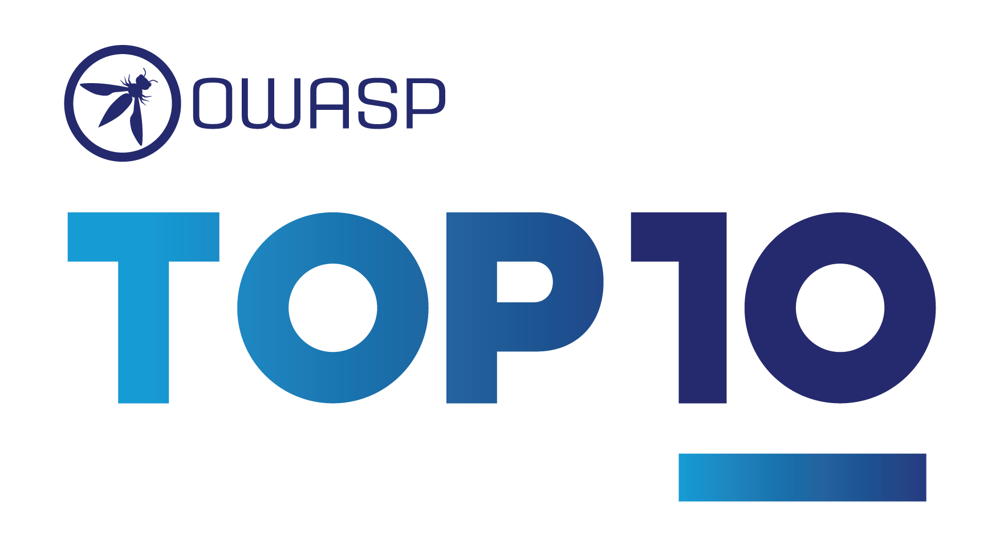

{ align=right width=180 }

O OWASP Top Dez é uma lista muito conhecida de riscos de segurança de aplicações web,
e está incluído no Modelo de Maturidade de Software Assurance do OWASP [(SAMM)][samm]
na prática de Educação e Orientação dentro da função de negócios de Governança.

#### Visão geral

O projeto [Top 10 Riscos de Segurança de Aplicações Web][top10project] do OWASP é provavelmente o conceito de segurança
mais conhecido dentro da comunidade de segurança, alcançando ampla aceitação e fama logo após seu lançamento em 2003.
Muitas vezes referida apenas como 'OWASP Top Dez', é uma lista que identifica as ameaças mais importantes
para aplicações web e busca classificá-las de acordo com sua importância e gravidade.

A lista mudou ao longo do tempo, com alguns tipos de ameaças se tornando um problema maior para aplicações web
e outras ameaças passando a ter um grau menor de risco à medida que as tecnologias mudam.
A [versão mais recente][top10] foi lançada em 2021 e cada categoria está resumida abaixo.

Observe que existem vários projetos 'OWASP Top Dez', por exemplo, o 'OWASP Top 10 para Aplicações de Modelos de
Linguagem de Grande Escala', portanto, para evitar confusão, o contexto deve ser observado ao se referir a essas listas.

#### A01:2021 Controle de Acesso Quebrado

Controle de acesso envolve a utilização de mecanismos de proteção que podem ser categorizados como:

* Autenticação (comprovando a identidade de um ator)
* Autorização (assegurando-se de que um determinado ator pode acessar um recurso)
* Prestação de contas (registro de atividades realizadas)

Controle de acesso quebrado é quando o produto não restringe ou restringe incorretamente o acesso a um recurso
de um ator não autorizado ou malicioso.
Quando um controle de segurança falha ou não é aplicado, invasores podem comprometer a segurança do produto
ganhando privilégios, lendo informações confidenciais, executando comandos, evitando detecção, etc.

Controle de Acesso Quebrado pode assumir muitas formas, tais como path traversal ou elevação de privilégio,
portanto, consulte a [Enumeração de Fraqueza Comum CWE-284][cwe284] e o [Controle de Acesso Quebrado A01][a01]
e também siga as diversas [Folhas de Dicas do OWASP][a01cs] relacionadas a controles de acesso.

#### A02:2021 Falhas Criptográficas

De acordo com [OWASP Top 10 A02:2021][a02], dados confidenciais devem ser protegidos quando em repouso e em trânsito.
Falhas criptográficas ocorrem quando o controle de segurança criptográfica é quebrado ou não aplicado,
e os dados são expostos a atores não autorizados – maliciosos ou não.

É importante proteger dados tanto em repouso, quando armazenados em uma área da memória,
quanto em trânsito, como sendo transmitido através de um canal de comunicação ou sendo transformado.
Um bom exemplo de proteção na transformação de dados é dado na categoria [A02 Falhas Criptográficas][a02]
onde os dados confidenciais são criptografados adequadamente em um banco de dados, mas a função de exportação descriptografa
os dados automaticamente, levando à exposição de dados confidenciais.

Falhas de criptografia podem assumir muitas formas e podem ser sutis – um controle de
segurança que parece seguro pode ser facilmente quebrado.
Siga as [Folhas de Dicas do OWASP][a02cs] de criptografia para pôr os controles básicos de criptografia em vigor
e considere implementar uma auditoria de criptografia.

#### A03:2021 Injeção

A falta de validação e sanitização de entrada pode levar a exploits de injeção,
e esse risco tem sido uma característica constante do OWASP Top Dez desde que a primeira versão foi publicada em 2003.
Essas vulnerabilidades ocorrem quando dados hostis são usados ​​diretamente na aplicação e podem resultar
em dados maliciosos sendo usados ​​para subverter a aplicação; veja [A03 Injeção][a03] para mais explicações.

O controle de segurança é direto: todas as entradas de fontes não confiáveis ​​devem ser sanitizadas e validadas.
Veja as [Injection Cheat Sheets][a03cs] para os vários tipos de entrada e seus controles.

#### A04:2021 Design Inseguro

É importante que segurança seja incorporada em aplicações desde o início e não aplicada como uma reflexão tardia.
A categoria [A04 Design Inseguro][a04] reconhece isso e aconselha que
o uso de modelagem de ameaças, padrões de design seguros e arquiteturas de referência
deve ser incorporado às atividades de design e arquitetura da aplicação.

Na prática, isso envolve estabelecer um ciclo de desenvolvimento seguro que incentive
a identificação de requisitos de segurança, o uso periódico de modelagem de ameaças
e a consideração de bibliotecas e frameworks seguros existentes.
Esta categoria foi introduzida na versão de 2021 e, por enquanto,
as folhas de dicas de suporte cobrem apenas [modelagem de ameaças][cstm];
à medida que esta categoria se torna mais estabelecida, espera-se que mais informação de suporte se torne disponível.

#### A05:2021 Configuração Incorreta de Segurança

Sistemas e aplicações grandes podem ser configuráveis, e essa configuração é
frequentemente usada para proteger o sistema/aplicação.
Se essa configuração for mal aplicada, a aplicação pode não ser mais segura
e, em vez disso, ficar vulnerável a exploits bem conhecidos. A página [A05 Configuração Incorreta de Segurança][a05] contém
um exemplo comum de configuração incorreta em que contas padrão e suas senhas ainda estão habilitadas e inalteradas.
Essas senhas e contas são geralmente bem conhecidas e fornecem uma maneira
fácil para agentes maliciosos comprometerem aplicações.

Tanto o [OWASP Top 10 A05:2021][a05] quanto as [Folhas de Dicas do OWASP][a05cs] vinculadas fornecem estratégias para
estabelecer um processo de configuração de segurança de aplicação repetível
e coordenado para minimizar configuração incorreta.

#### A06:2021 Componentes Vulneráveis e Desatualizados

Talvez uma das atividades de segurança mais fáceis e eficazes
seja manter todas as dependências de software de terceiros atualizadas.
Se uma dependência vulnerável for identificada por um agente malicioso durante a fase de reconhecimento de um ataque
então há bancos de dados disponíveis, como o [Exploit Database][exploit],
que fornecerão uma descrição de qualquer exploração.
Esses bancos de dados também podem fornecer scripts e técnicas prontos para atacar uma determinada vulnerabilidade,
fazendo que dependências vulneráveis ​​de software de terceiros sejam mais facilmente exploradas.

O risco [A06 Componentes Vulneráveis ​​e Desatualizados][a06] destaca a importância dessa atividade,
e recomenda que correções e atualizações para a plataforma, estruturas e dependências subjacentes
sejam baseadas em uma avaliação de risco e feitas de forma 'oportuna'.
Várias ferramentas podem ser usadas para analisar dependências e sinalizar vulnerabilidades,
consulte as [Folhas de Dicas][a06cs] para elas.

#### A07:2021 Falhas de Identificação e Autenticação

Confirmação da identidade do usuário, autenticação e gerenciamento de sessão é essencial
para proteger o sistema ou aplicação contra ataques relacionados à autenticação.
De acordo com o risco [A07 Falhas de Identificação e Autenticação][a07], a autorização pode falhar de várias maneiras
que frequentemente envolvem outros riscos do OWASP Top Ten:

* controles de acesso quebrados (A01)
* falha criptográfica (A02)
* senhas padrão (A05)
* bibliotecas desatualizadas (A06)

Consulte as [Folhas de Dicas][a07cs] para as várias boas práticas necessárias para autorização segura.
Há também fornecedores terceirizados de Gerenciamento de Identidade e Acesso (IAM) que fornecerão isso como um serviço,
considere o custo/benefício de usar esses fornecedores (geralmente comerciais).

#### A08:2021 Falhas de Integridade de Software e de Dados

Falhas de integridade de software e de dados estão relacionadas a código e
infraestrutura que não protegem contra violações de integridade.
Esta é uma categoria abrangente que descreve [ataques à cadeia de suprimento][cschain],
atualização automática comprometida e uso de componentes não confiáveis, por exemplo.
[A07 Falhas de Integridade de Software e de Dados][a08] foi uma nova categoria introduzida em 2021
então há pouca informação disponível nas [Folhas de Dicas][a08cs],
mas isso certamente mudará para uma ameaça tão importante.

#### A09:2021 Falhas de Registro e Monitoramento de Segurança

Registro e o monitoramento ajudam a detectar, escalar e responder a violações ativas;
sem isso, as violações não serão detectadas.
[A09 Falhas de registro e monitoramento de segurança][a09] lista várias técnicas de registro e monitoramento que devem ser
familiares, mas também outras que podem não ser tão comuns;
por exemplo, monitorar a cadeia de suprimento de DevOps pode ser tão importante quanto monitorar a aplicação ou sistema.
As [Folhas de Dicas][a09cs] fornecem orientação sobre registro adequado e também fornecem um vocabulário comum de registro.
O objetivo deste vocabulário comum é fornecer registro que use um conjunto comum de termos, formatos e palavras-chave;
e isso permite monitoramento, análise e alerta mais fáceis.

#### A10:2021 Falsificação de Solicitação do Lado do Servidor

Referindo-se a [A10 Falsificação de Solicitação do Lado do Servidor (SSRF)][a10], essas vulnerabilidades podem ocorrer
sempre que uma aplicação web estiver buscando um recurso remoto sem validar a URL fornecida pelo usuário.
Esses exploits permitem que um invasor coaja a aplicação a enviar uma requisição elaborada para um destino inesperado,
mesmo quando protegido por um firewall, VPN ou outro tipo de lista de controle de acesso à rede.
A solicitação de recursos de URLs se tornou um cenário comum para aplicações web modernas, como resultado, a incidência de
SSRF está aumentando, especialmente para [serviços na nuvem][cscloud] e arquiteturas de aplicações mais complexas.

Esta é uma nova categoria introduzida em 2021 com uma única (por enquanto) [Folha de Dicas][a10cs] que lida com SSRF.

#### OWASP top dez

Existem vários projetos 'Top 10' criados pelo OWASP que, dependendo do contexto,
também podem ser referidos como 'OWASP Top 10'. Aqui está uma lista dos projetos 'OWASP Top 10' estáveis:

* [API Security Top 10][apisec]
* [Citizen Development Top 10][cd10]
* [Data Security Top 10][data10]
* [Mobile Top 10][mobile10]
* [Serverless Top 10][serverless10]
* [Top 10 CI/CD Security Risks][cicd10]
* [Top 10 for Large Language Model Applications][llm10]
* [Top 10 Privacy Risks][privacy10]
* [Top 10 Proactive Controls][proactive10]
* [Top 10 Web Application Security Risks][top10]

Outros Top 10 do OWASP são projetos de “incubadoras”, que estão em andamento, portanto esta lista mudará com o tempo.

----

O Guia do Desenvolvedor do OWASP é um trabalho da comunidade; se há algo que precisa ser mudado
então [submeta uma issue][issue0405] ou [edite no GitHub][edit0405].

[a01]: https://top10.owasp.org/A01_2021-Broken_Access_Control/
[a01cs]: https://cheatsheetseries.owasp.org/IndexTopTen.html#a012021-broken-access-control
[a02]: https://top10.owasp.org/A02_2021-Cryptographic_Failures/
[a02cs]: https://cheatsheetseries.owasp.org/IndexTopTen.html#a022021-cryptographic-failures
[a03]: https://top10.owasp.org/A03_2021-Injection/
[a03cs]: https://cheatsheetseries.owasp.org/IndexTopTen.html#a032021-injection
[a04]: https://top10.owasp.org/A04_2021-Insecure_Design/
[a05]: https://top10.owasp.org/A05_2021-Security_Misconfiguration/
[a05cs]: https://cheatsheetseries.owasp.org/IndexTopTen.html#a052021-security-misconfiguration
[a06]: https://top10.owasp.org/A06_2021-Vulnerable_and_Outdated_Components/
[a06cs]: https://cheatsheetseries.owasp.org/IndexTopTen.html#a062021-vulnerable-and-outdated-components
[a07]: https://top10.owasp.org/A07_2021-Identification_and_Authentication_Failures/
[a07cs]: https://cheatsheetseries.owasp.org/IndexTopTen.html#a072021-identification-and-authentication-failures
[a08]: https://top10.owasp.org/A08_2021-Software_and_Data_Integrity_Failures/
[a08cs]: https://cheatsheetseries.owasp.org/IndexTopTen.html#a082021-software-and-data-integrity-failures
[a09]: https://top10.owasp.org/A09_2021-Security_Logging_and_Monitoring_Failures/
[a09cs]: https://cheatsheetseries.owasp.org/IndexTopTen.html#a092021-security-logging-and-monitoring-failures
[a10]: https://top10.owasp.org/A10_2021-Server-Side_Request_Forgery_%28SSRF%29/
[a10cs]: https://cheatsheetseries.owasp.org/IndexTopTen.html#a102021-server-side-request-forgery-ssrf
[apisec]: https://api-security.owasp.org/
[cd10]: https://owasp.org/projects/citizen-development-top-10
[cicd10]: https://owasp.org/projects/top-10-cicd-security-risks
[cschain]: https://cheatsheetseries.owasp.org/cheatsheets/Software_Supply_Chain_Security_Cheat_Sheet
[cscloud]: https://cheatsheetseries.owasp.org/cheatsheets/Secure_Cloud_Architecture_Cheat_Sheet
[cstm]: https://cheatsheetseries.owasp.org/cheatsheets/Threat_Modeling_Cheat_Sheet
[cwe284]: https://cwe.mitre.org/data/definitions/284.html
[data10]: https://owasp.org/projects/data-security-top-10
[edit0405]: https://github.com/OWASP/DevGuide/blob/main/docs/pt-br/02-foundations/05-top-ten.md
[exploit]: https://www.exploit-db.com/
[issue0405]: https://github.com/OWASP/DevGuide/issues/new?labels=enhancement&template=request.md&title=Update:%2002-foundations/05-top-ten
[mobile10]: https://owasp.org/projects/mobile-top-10
[privacy10]: https://owasp.org/projects/top-10-privacy-risks
[proactive10]: https://top10proactive.owasp.org/
[samm]: https://owaspsamm.org/about/
[serverless10]: https://owasp.org/projects/serverless-top-10
[top10project]: https://owasp.org/projects/top-ten
[top10]: https://top10.owasp.org/
[llm10]: https://owasp.org/projects/top-10-for-large-language-model-applications
