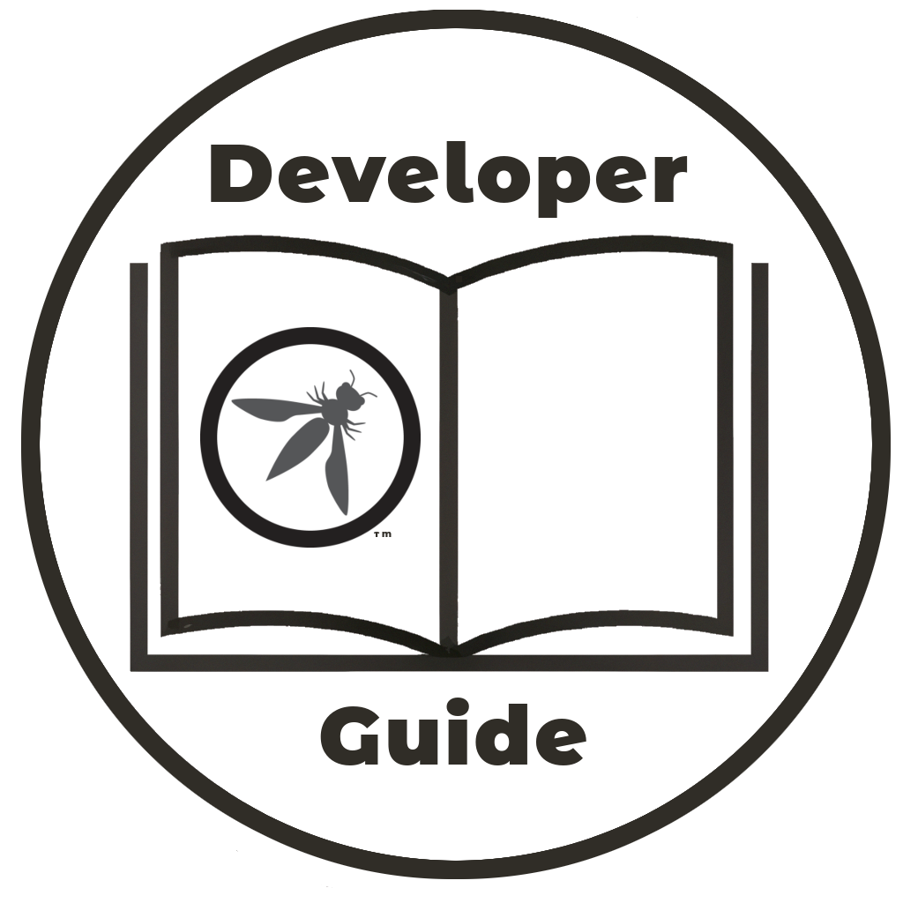
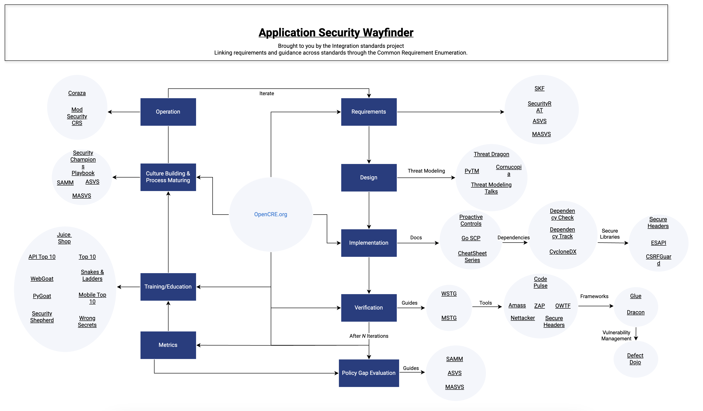

{ align=right width="180" }

Bem-vindo ao Guia de Desenvolvimento do OWASP.

O Open Worldwide Application Security Project ([OWASP][about]) é uma fundação sem fins lucrativos
que trabalha para melhorar a segurança de software.
Ela é uma comunidade aberta dedicada a possibilitar que organizações
concebam, desenvolvam, adquiram, operem e mantenham aplicações confiáveis.

Juntamente com o OWASP Top Dez, o Guia do Desenvolvedor é um dos recursos originais
publicado logo após a fundação OWASP ser formada em 2001.
A versão 1.0 do Guia do desenvolvedor foi lançada em 2002
e desde então houve vários [lançamentos][versions] culminando na versão 2.0 em 2005.
Desde então, o guia foi extensivamente revisado para que mantenha-se atualizado.
As versões mais recentes são 4.x porque a versão 3.0 nunca foi lançada.

O propósito deste guia é fornecer uma introdução aos conceitos de segurança
e uma referência útil para desenvolvedores de aplicações/sistemas.
Ele geralmente descreve práticas de segurança usando os conselhos dados no
Modelo de Maturidade de Software Assurance do OWASP ([SAMM][samm]) e descreve os projetos do OWASP
referenciados no projeto [Application Security Wayfinder][intstand] do OWASP.

Este guia não procura replicar as muitas fontes excelentes sobre tópicos específicos de segurança;
ele raramente tentará entrar em detalhes sobre um assunto e, em vez disso, fornecerá links com maior
profundidade nesses tópicos de segurança.
Em vez disso, o conteúdo do Guia do Desenvolvedor tem por finalidade ser acessível,
introduzindo conceitos práticos de segurança e fornecendo detalhes suficientes para que desenvolvedores
comecem a usar várias ferramentas e documentos do OWASP.

Todos os projetos e ferramentas do OWASP descritos neste guia são gratuitos para download e uso.
Todos os projetos do OWASP são de código aberto; participe se estiver interessado em melhorar a segurança de aplicações.

#### Público-alvo

Desenvolvedores devem usar este Guia do Desenvolvedor do OWASP para ajudar a escrever aplicações mais seguras.
O guia foi escrito pela comunidade de segurança para ajudar desenvolvedores de software a escreverem aplicações sólidas,
seguras e protegidas.
A maioria dos colaboradores deste guia também são desenvolvedores de software e engenheiros de segurança,
e isso ajuda a manter o foco centrado no desenvolvedor.

Se você está com pressa e deseja informações sobre um assunto específico, então
experimente o LLM do [OpenCRE chat][opencrechat] para respostas imediatas.

#### O que é o Guia do Desenvolvedor?

Você pode pensar neste guia como uma fonte de referência cruzada para as diversas ferramentas e documentos
que o OWASP fornece aos desenvolvedores.

Ou você pode considerar que o objetivo deste guia seja de responder à pergunta:
 “Sou desenvolvedor e preciso de um guia de referência para navegar as inúmeras ferramentas de segurança
 e atividades de segurança que eu sei que deveria realizar.

Ou pense nele como uma coleção de artigos que apresentam aos desenvolvedores o amplo domínio da segurança de aplicações.

Ou você pode considerar este guia como um documento complementar ao projeto [Padrões de Integração][intstand] do OWASP:
o Application Security Wayfinder mapeia as muitas ferramentas,
projetos e documentos dentro do OWASP, e o Guia do Desenvolvedor fornece um contexto 'verboso'.

[][intstand]

----

O Guia do Desenvolvedor do OWASP é um trabalho da comunidade; se há algo que precisa ser mudado
então [submeta uma issue][issue03] ou [edite no GitHub][edit03].

[about]: https://owasp.org/about/
[edit03]: https://github.com/OWASP/DevGuide/blob/main/docs/pt-br/index.md
[intstand]: https://owasp.org/projects/integration-standards/
[issue03]: https://github.com/OWASP/DevGuide/issues/new?labels=enhancement&template=request.md&title=Update:%2001-introduction
[opencrechat]: https://www.opencre.org/chatbot
[samm]: https://owaspsamm.org/about/
[versions]: https://github.com/OWASP/DevGuide/wiki#old-versions
